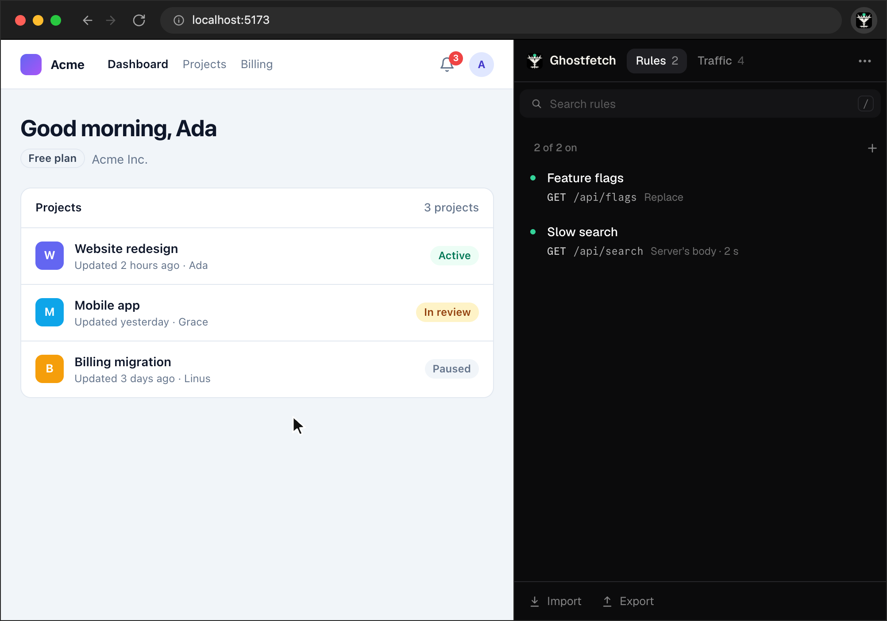
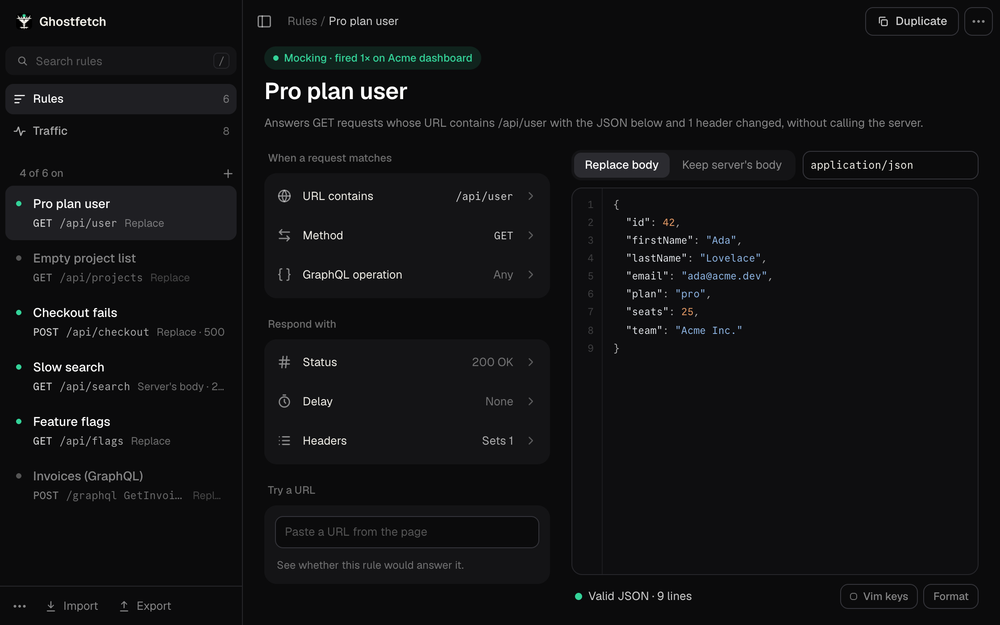
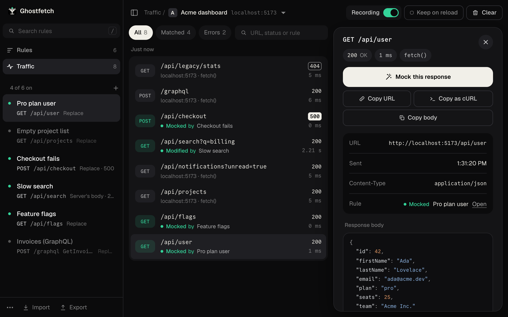
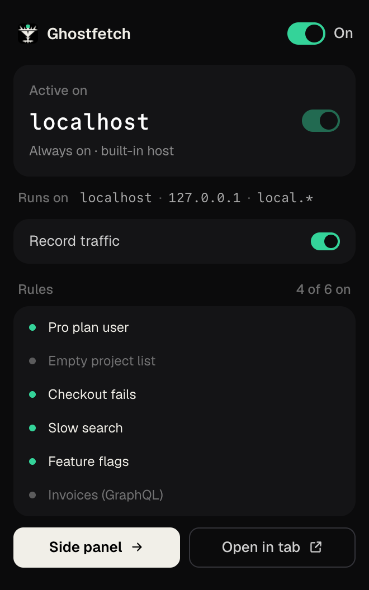
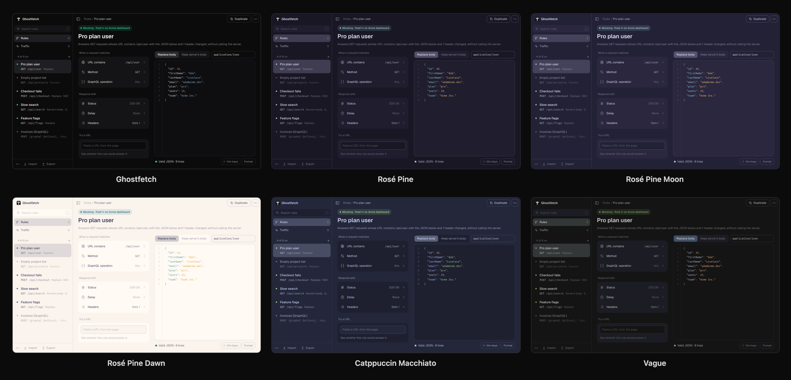

<p align="center">
  
</p>

<h1 align="center">Ghostfetch</h1>

<p align="center">
  Mock and modify the API responses your web app gets, right in the browser.<br>
  For Chrome and Firefox-based browsers such as Zen. It runs locally and makes no network
  calls of its own.
</p>

<p align="center">
  <a href="https://github.com/rauf322/ghostfetch/releases/latest"><b>Download</b></a> ·
  <a href="#install">Install</a> ·
  <a href="docs/guide.md">Guide</a> ·
  <a href="docs/development.md">Development</a>
</p>


Ghostfetch opens next to the app you're working on, in Chrome's side panel or the sidebar of Zen
and Firefox. It lists the requests the page makes, and answers the ones you pick with whatever
you need: another body, another status, an error, a delay. There's no proxy to set up and
nothing to change in your app or on your server, and changes apply as you type. (In Irish
folklore a *fetch* is the ghostly double of a living person; here it's the double of your API.)

## What it does

### Mock a response from real traffic

**Traffic** lists the page's `fetch()` and `XMLHttpRequest` calls as they happen. Open one and
click **Mock this response**: it becomes a rule with the real method, path, status and body,
ready to edit, as in the recording above.

### Try failures, empty states and slow responses



**New rule** (the **+**) takes a path, a full URL, or a command from the browser's **Copy as
cURL**. One click sets a common answer: **Empty list**, **Fail with 500**, **Not found**, **Slow
by 2 s** or **Logged out (401)**. A rule's dot turns it on or off, in the list and in the popup.

### Shape every part of the answer



- Match a request by its URL (contains, equals, wildcard or regex), its method and its GraphQL
  operation name. **Try a URL** says whether a rule would answer one.
- Answer with your own body, or keep the server's and change only the status, headers or
  delay.
- The body editor checks JSON as you type, formats it, searches it (**⌘F**), zooms (**⌘=**
  and **⌘−**) and has [vim keys](docs/guide.md#vim-keys).
- Rules apply in the list's order and the first match wins: drag one to move it. Changes save
  as you type and apply to open tabs right away.
- Export rules to a JSON file, and import them again (imported rules arrive switched off).

### See what each request got



Every request with its status, timing and body, and what a rule did to it ("Mocked by Pro plan
user"). Filter to the ones a rule **Matched** or the **Errors**, search by URL, status or rule,
and copy a request's URL, its body or a cURL command for it.

### Switch it from the toolbar

<p align="center">
  
</p>

The popup turns Ghostfetch on or off, says whether it runs on the current site (and turns it on
for one that isn't built in), turns recording on or off, has every rule's dot, and opens the
editor.

### Pick a theme



Ghostfetch's own near-black look, or Rosé Pine, Rosé Pine Moon, Rosé Pine Dawn (light),
Catppuccin Macchiato or Vague, in the colours their Neovim themes use. **Theme** is in the
editor's `⋯` menu.

## Install

Download the packages from the [latest release](https://github.com/rauf322/ghostfetch/releases/latest).

**Chrome (121 or later).** Unzip `ghostfetch-<version>-chrome.zip`. Open `chrome://extensions`,
turn on **Developer mode** (top right), click **Load unpacked** and pick the unzipped folder. Pin
Ghostfetch from the puzzle-piece menu, and reload any tabs that were already open. To update,
unzip the new version over the same folder and click the reload arrow on Ghostfetch's card: the
extension keeps its ID, and your rules with it.

**Zen, Firefox Developer Edition and Nightly (140 or later).** Ghostfetch isn't signed by
Mozilla, so first set `xpinstall.signatures.required` to `false` in `about:config` (this turns
signature checks off for every add-on in that profile). Then open `about:addons`, choose
**Install Add-on From File…** in its gear menu and pick `ghostfetch-<version>-firefox.zip`. A
newer version installs over the old one and keeps your rules. The editor opens in the browser's
sidebar.

**Firefox** itself only keeps signed add-ons. To try Ghostfetch until the browser restarts, open
`about:debugging#/runtime/this-firefox`, click **Load Temporary Add-on…** and pick the zip.

## Where it runs

Always on `localhost` (any port, and `*.localhost`), `127.0.0.1` and any host that starts with
`local.`, such as `local.myapp.com`. Turn it on for another site from the popup (**Active on …**)
or from Traffic (**Turn on for …**); a site covers its subdomains. Everywhere else it doesn't
run at all.

## Privacy

- No network requests of its own: no account and no analytics, its fonts are bundled, and cURL
  commands and URLs are read inside the extension.
- Rules stay in the browser's extension storage on your machine.
- The packages are plain, unminified JavaScript built from this repository, so what you install
  can be read.
- Scripts on the sites Ghostfetch runs on can see the answers its rules give, so only turn it on
  for sites you trust, and keep real secrets out of rule bodies. The
  [security model](docs/security-model.md) has the details.

## Limits

- Rules answer `fetch()` and `XMLHttpRequest` calls made by page scripts, not `<script>` or
  `` loads, WebSockets, or requests from service workers.
- Traffic keeps the last 300 requests per tab, with response bodies up to 1 MB.

The rest are in the [guide](docs/guide.md#limits-worth-knowing).

## Build from source

This is what the sources zip on addons.mozilla.org is for. On macOS or Linux, with Node.js 24
(built with 24.9.0) and npm 11:

```sh
npm ci
npm run zip
```

The Firefox build is then in `.output/firefox-mv3`, packed as
`web-ext-artifacts/ghostfetch-<version>-firefox.zip`; `npm run zip` also builds Chrome's
(`.output/chrome-mv3`). The output isn't minified. Every file in it comes from `src/` and
`public/`, except `chunks/libraries-*.js`: the npm packages the popup and the editor use (React
and Base UI, see the [security model](docs/security-model.md)), at the versions in
`package-lock.json`. Tailwind writes the stylesheet from the class names in `src/`. Building
again from the same sources gives the same files, byte for byte; `node scripts/check-sources.mjs`
checks exactly that (add `--docker` to do it in a clean Linux container).

To work on Ghostfetch (a build that reloads as you edit, how the code is laid out, the UI kit
and the tests), see [docs/development.md](docs/development.md).
